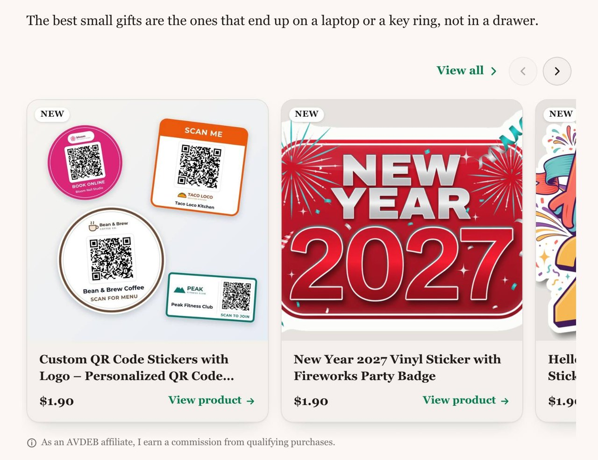

# nuxt-avdeb

Show [AVDEB](https://avdeb.com/developers/#nuxt) products on your Nuxt site (a creator's shop, a category, a search or a single product) with **your affiliate referral code on every link**.



- **Components:** `<AvdebProducts>`, `<AvdebProduct>` and `<AvdebButton>` are registered globally, so they work in pages, components and **Nuxt Content Markdown** (`::avdeb-products{…}`).
- **Four layouts:** grid, carousel (scroll-snap with keyboard and arrow buttons), list ("shop the post") and spotlight. Single products render as a horizontal card, a hero or a compact card, with your own badge and note.
- **Fits your design:** container queries let embeds adapt to the column they sit in. Choose inherit, light, dark or system theme, plus card style, accent colour, radius and image shape. Styles use `:where()` (zero specificity), so your CSS always wins, and `--avdeb-*` custom properties restyle everything. Or use `useAvdebProducts()` for your own markup.
- **SSR, static and SPA:** products are fetched on the server and included in the page payload. Works with `nuxt build`, `nuxt generate` and client-side navigation, with no layout shift.
- **Your key stays secret:** the browser only talks to a small route on your own server (`/api/_avdeb`). The secret key never reaches the client.
- **Fast and resilient:** responses are cached in Nitro storage (memory by default; Redis, Cloudflare KV or any driver you mount). If AVDEB can't be reached, the last good copy is served for a week.
- **Honest links:** referral links get `rel="sponsored"`, and an optional affiliate disclosure appears under embeds that carry a code.
- **Private by default:** no third-party scripts, cookies, iframes or tracking.

## Requirements

- Nuxt 4, or Nuxt 3.17 and later
- Node.js 20 or later

## Installation

```sh
npm install nuxt-avdeb
```

```ts
// nuxt.config.ts
export default defineNuxtConfig({
	modules: ["nuxt-avdeb"],
	avdeb: {
		refCode: "YOURCODE",
	},
});
```

## Configuration

Your referral code is added as `?ref=` to every AVDEB link. Instead of putting it in the config, you can set it as an environment variable (or in `.env`). The referral code is read at build time and can be changed at run time; the secret key is only read at run time, by the server:

```sh
NUXT_AVDEB_REF_CODE=YOURCODE
# Optional: with a secret key your code is added automatically and embeds can show up to 48 products (12 without).
NUXT_AVDEB_API_KEY=avdeb_sk_…
```

`AVDEB_REF_CODE` and `AVDEB_SECRET_KEY` work too. Keep the secret key out of `nuxt.config` and out of git. It's only used by the server route.

| Option | Default | |
| --- | --- | --- |
| `refCode` | `NUXT_AVDEB_REF_CODE` | Your referral code |
| `apiKey` | `NUXT_AVDEB_API_KEY` | Secret key (`avdeb_sk_…`), server only |
| `layout` | `"grid"` | `grid`, `carousel`, `list`, `spotlight` |
| `columns` | `3` | 1–6 (narrow columns get fewer automatically) |
| `cardStyle` | `"elevated"` | `elevated`, `outline`, `minimal` |
| `theme` | `"site"` | `site` (inherit your colours and fonts), `light`, `dark`, `auto` |
| `accentColor` | AVDEB green | Hex colour for buttons and highlights |
| `radius` | `16` | Corner radius in px (0–32) |
| `imageRatio` | `"square"` | `square`, `portrait`, `landscape` |
| `ctaLabel` | `"View product"` | Button text on cards |
| `showPrice`, `showCreator`, `showBadges` | `true` | Card details |
| `newTab` | `false` | Open product links in a new tab |
| `showDisclosure` | `true` | Affiliate disclosure under embeds that carry a code |
| `disclosureText` | "As an AVDEB affiliate, I earn a commission from qualifying purchases." | |
| `cacheMinutes` | `360` | How long fetched products stay fresh (5–2880) |
| `locale` | `"en-US"` | Price formatting (each embed can set its own `locale`) |
| `css` | `true` | Add the default stylesheet |
| `prefix` | `"Avdeb"` | Component name prefix |
| `apiBase` | `"/api/_avdeb"` | Route of the server endpoints |

`NUXT_AVDEB_REF_CODE` and `NUXT_AVDEB_API_KEY` are read at runtime too, so one build can serve several sites.

### Become an AVDEB affiliate

Free to join: 5% commission, 30-day cookie, monthly PayPal payouts in USD ($50 minimum), open worldwide.
Apply at [avdeb.com/affiliate/apply](https://avdeb.com/affiliate/apply/). After approval, copy your referral code (or create a secret key) in the [partner dashboard](https://avdeb.com/affiliate/dashboard/developers/).

## Usage

### Components

```vue
<template>
	<!-- Any AVDEB creator, category or product link; the source is detected automatically -->
	<AvdebProducts url="https://avdeb.com/creators/cleo/" heading="From my shop" />

	<AvdebProducts tag="stickers" layout="carousel" :columns="4" :limit="10" />
	<AvdebProducts q="keychain" layout="list" :limit="3" />
	<AvdebProducts tag="3d-prints" layout="spotlight" theme="dark" accent-color="#e0a84f" />

	<AvdebProduct product="https://avdeb.com/store/custom-qr-code-stickers/" variant="hero" badge="Editor's pick" note="I use it every day." />

	<AvdebButton href="/creators/cleo/" label="Visit my shop" variant="outline" align="center" />
</template>
```

`<AvdebProducts>` props: `url`, `creator`, `tag`, `type`, `q` (leave all empty for the newest products), `limit`, `layout`, `columns`, `heading`, `intro`, `heading-level`, `view-all`, `view-all-label`, `card-style`, `theme`, `accent-color`, `radius`, `image-ratio`, `cta-label`, `hide-price`, `hide-creator`, `hide-badges`, `new-tab`, `locale`.
`<AvdebProduct>`: `product` (a product link or handle), `variant` (horizontal, hero, card), `badge`, `note`, plus the display props.
`<AvdebButton>`: `href`, `label`, `variant` (solid, outline, link), `align` (start, center, end), `new-tab`, `accent-color`.

### Nuxt Content (Markdown)

The components are global, so you can use them in any Nuxt Content page with MDC syntax:

```md
The best small gifts end up on a laptop or a key ring.

::avdeb-products{url="https://avdeb.com/category/stickers/" layout="carousel"}
::

::avdeb-product{product="https://avdeb.com/store/custom-qr-code-keychain/" variant="hero"}
::

::avdeb-button{href="/creators/" label="Meet the makers" variant="outline"}
::
```

### Your own markup

`useAvdebProducts()` is auto-imported and returns the same data the components use:

```vue
<script setup lang="ts">
const { data } = await useAvdebProducts({ tag: "stickers", limit: 4 });
</script>

<template>
	<ul>
		<li v-for="card in data?.cards" :key="card.key">
			<a :href="card.href" :rel="card.rel"> {{ card.title }} — {{ card.price }}</a>
		</li>
	</ul>
	<small v-if="data?.disclosure">{{ data.disclosure }}</small>
</template>
```

Each card has `href` (with your referral code), `rel`, `target`, `title`, `image`, `width`, `height`, `price`, `compareAt`, `discount`, `isNew` and `creator`. Raw products are in `data.products`, the "view all" link in `data.viewAll`. The input can be a ref or getter, and the data refreshes when it changes. You can also pass `data` to `<AvdebEmbed :payload="data" />` to use the built-in markup.

## Styling

Every rule is `:where()`-wrapped, so your CSS wins. Set tokens in your stylesheet:

```css
.avdeb {
	--avdeb-accent: #7c3aed;
	--avdeb-radius: 4px;
	--avdeb-card-bg: #fff;
	--avdeb-font-title: Georgia, serif;
}
```

Tokens: `--avdeb-accent`, `--avdeb-accent-contrast`, `--avdeb-surface`, `--avdeb-card-bg`, `--avdeb-card-pad`, `--avdeb-border`, `--avdeb-muted`,
`--avdeb-badge-bg`, `--avdeb-badge-text`, `--avdeb-shadow`, `--avdeb-shadow-hover`, `--avdeb-radius`, `--avdeb-ratio`, `--avdeb-gap`, `--avdeb-pad`,
`--avdeb-font-title`, `--avdeb-heading-size`, `--avdeb-title-size`, `--avdeb-price-size`, `--avdeb-btn-bg`, `--avdeb-btn-color`, `--avdeb-btn-shadow`.

The markup uses stable BEM classes (`.avdeb`, `.avdeb--{layout}`, `.avdeb-card`, `.avdeb-card__title`, `.avdeb-card__price`, `.avdeb-btn`…) and `.not-prose`, so Tailwind Typography leaves it alone. To ship your own styles only, set `css: false`.

## How it works

- Components call `GET /api/_avdeb/products` with their props. That route calls `https://api.avdeb.com/v1/catalog/products` from your server. With a secret key, requests send `Authorization: Bearer avdeb_sk_…` and the API returns links that already carry your code; without one, `?ref=` is added to every link.
- Each query is cached in the `avdeb` Nitro storage mount. Fresh results are reused for `cacheMinutes`; a failed request serves the last good result (up to a week old) and retries after 15 minutes. At most 120 API calls a minute are made. To share the cache between server instances, mount a persistent driver:

  ```ts
  nitro: { storage: { avdeb: { driver: "redis", url: process.env.REDIS_URL } } }
  ```

- With `nuxt generate`, products are fetched while prerendering and stored in the page payload, so static hosting works without the server route. Rebuild regularly to refresh prices.
- All product data is validated before rendering: only `https://avdeb.com` links and `https://` images get through, and Vue escapes every value.

## Development

```sh
npm install
npm run dev:prepare   # build stubs and types
npm run dev           # playground blog with Nuxt Content → http://localhost:3000
npm test              # unit tests and an end-to-end Nuxt build (calls the live API)
```

## Support

Issues and ideas: [github.com/Avdebcom/nuxt-avdeb/issues](https://github.com/Avdebcom/nuxt-avdeb/issues). More integrations: [avdeb.com/developers](https://avdeb.com/developers/).

## License

MIT © AVDEB
